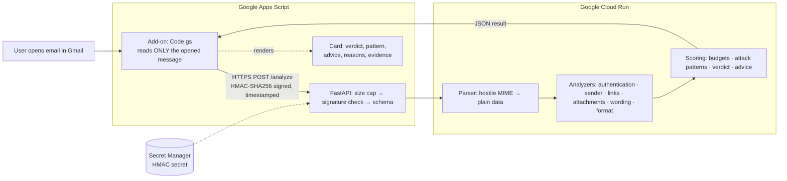

# MailGuard

A Gmail add-on that analyzes the email you open and tells you, in plain language, **how risky it
is, what kind of attack it looks like, why, and what to do**.

```
MailGuard                                   Malicious · 100/100
Verdict: Malicious              ■■■■■■■■■■
Looks like: Credential phishing
  The email uses a deceptive sender or link and asks for your password or account details.
What to do
  Do not enter your password or payment details. If you think the account issue is real,
  open the website yourself by typing its address.
Why
  +30 · Sender     Sender name claims to be PayPal
  +30 · Links      Link text hides the real destination
  +20 · Attack pattern  Several findings point to credential phishing
  +20 · Sender     Sender domain imitates PayPal
  ...
Sender authentication
  SPF pass · DKIM pass · DMARC pass — reported by Gmail, not re-checked by MailGuard
Technical details (collapsed): every finding with its evidence, links shown as hxxps://evil[.]example
```

*(Text rendering of the Gmail card for [`demo/02_credential_phishing.eml`](demo/02_credential_phishing.eml).
Note that this phishing email **passes** SPF, DKIM and DMARC: the attacker authenticated their own
look-alike domain. Authentication alone would have called it safe.)*

## Contents

1. [What it does and why](#1-what-it-does-and-why)
2. [Architecture](#2-architecture)
3. [How MailGuard decides](#3-how-mailguard-decides)
4. [Security design](#4-security-design)
5. [Testing and evaluation](#5-testing-and-evaluation)
6. [Running it](#6-running-it)
7. [Deployment](#7-deployment)
8. [Trade-offs, limitations and future work](#8-trade-offs-limitations-and-future-work)
9. [Repository layout](#9-repository-layout)

## 1. What it does and why

When you open an email, MailGuard shows a card in Gmail's sidebar with:

- **A verdict:** *Low risk*, *Suspicious*, *Malicious*, or *Inconclusive* when the email could
  not be fully analyzed (MailGuard never calls a partially checked email "safe").
- **A score from 0 to 100**, where the points on the card add up to the score.
- **The attack it resembles** (credential phishing, payment fraud, malware delivery, sender
  spoofing) and **concrete advice** for that attack.
- **The reasons**, each with evidence, and an explicit list of **what could not be checked**.

**Product decisions**

| Decision | Why |
|---|---|
| Explain attacks, not just scores | A number alone does not change behavior. "Looks like payment fraud: confirm by phone using a number you already know" does. |
| Corroboration over keywords | Real phishing combines tricks (a look-alike link *and* a password request). MailGuard rewards independent evidence that agrees, and caps weak evidence such as wording. |
| Honest uncertainty | Encrypted archives, malformed messages or truncated content give *Inconclusive*, never *Low risk*. Missing authentication results are disclosed, not treated as failures. |
| Privacy first | Only the opened message is read, it is never stored, and its links are never visited. Logs contain size, score and verdict only. |
| Low false-alarm rate | A security tool that cries wolf gets ignored. Every analyzer was tested against realistic *legitimate* email (newsletters with tracking links, security-gateway rewrites, e-invoices, password-reset emails). |

## 2. Architecture



**Data flow for one email**

1. Gmail runs the add-on's contextual trigger. With a **per-message access token** it reads the raw
   RFC 822 source of *only* the opened email (`gmail.addons.current.message.readonly` scope).
2. The add-on base64url-encodes it and sends it to Cloud Run, signed with
   `HMAC-SHA256(secret, "<timestamp>.<body>")`. Outbound calls are restricted to the backend by the
   manifest's `urlFetchWhitelist`; redirects are not followed.
3. The backend checks, **in this order**: body size, signature and freshness, then JSON schema and
   base64. Unauthenticated input never reaches a parser.
4. `parse_email()` turns the untrusted bytes into a plain `ParsedEmail` object once. It never
   raises: malformed input is recorded as *defects*.
5. Six analyzers each return **signals** (id, title, points, explanation, evidence). URLs found
   inside PDF/HTML attachments are passed to the link analyzer.
6. The scoring engine applies category budgets, recognizes attack patterns, and produces the
   verdict, summary and advice.
7. The add-on **validates every field** of the response, HTML-escapes all text, and renders the card.

**Why this split.** The add-on is a thin client (≈380 lines): Apps Script is hard to test and
version, while the Python backend carries all detection logic behind 500+ automated tests. The
backend is stateless, so it scales to zero when idle.

| Component | Key files |
|---|---|
| Add-on | [`addon/Code.gs`](addon/Code.gs), [`addon/appsscript.json`](addon/appsscript.json) |
| HTTP layer and request authentication | [`app/main.py`](backend/app/main.py), [`app/security.py`](backend/app/security.py), [`app/config.py`](backend/app/config.py) |
| Parser | [`app/parsing.py`](backend/app/parsing.py) |
| Analyzers | [`app/analyzers/`](backend/app/analyzers/) |
| Scoring and advice | [`app/scoring.py`](backend/app/scoring.py), [`app/pipeline.py`](backend/app/pipeline.py) |
| Offline analyzer (CLI) | [`app/cli.py`](backend/app/cli.py) |

## 3. How MailGuard decides

### Signals

Each analyzer emits signals with fixed, documented points. Examples are representative; the full
list with plain-language explanations is in the code and shown on the card.

| Category (budget) | Signals (points) |
|---|---|
| **Authentication** (40) | DMARC fail (35) · SPF fail (15) / softfail (8) · DKIM fail (15) · no DMARC policy (5). Ignored when DMARC passes, because forwarding breaks SPF innocently. |
| **Sender** (50) | Display name claims a brand from another domain or from free webmail (30) · look-alike domain: homoglyph `paypa1`, typo `paypall`, extra words `paypal-secure`, brand as subdomain `paypal.evil.example` (30) · replies go to free webmail (25) / another organization (15) · address hidden in display name (25) · multiple From (20) · punycode domain (15) · hidden bidi/zero-width characters (15) · no valid sender (10) |
| **Links** (50) | Text shows a different domain than the link (30) · look-alike domain (30) · `user@host` disguise (25) · program download (25) · form inside the email (25) · bare or obfuscated IP such as `http://3232235777` (20) · `javascript:`, `data:`, `file:`, `ms-msdt:` schemes (20) · shortener (10) · punycode (10) · abused TLD such as `.top` or `.zip` (10) |
| **Attachments** (60) | Program, script, shortcut or disk image (40) · disguised: `invoice.pdf.exe`, RTLO name, "PDF" that is really a program (35) · archive containing a program (35) · Office macros (30) · HTML/SVG with scripts or forms (30) / plain (15) · PDF with JavaScript or an embedded program, RTF with objects (25) · password-protected archive (20, or 30 if the password is in the email) |
| **Wording** (25) | Credential request (15) · payment or bank-detail request (15) · secrecy or "quick favor" (10) · prize or refund (10) · urgency (5) · "Dear customer" (5) |
| **Format** (10) | Malformed MIME structure (5) |

**Normalization before judging.** Links are normalized the way browsers interpret them
(`https:\\evil`, `http:/host`, entity- and percent-encoding, `user@host`, nested redirect targets
inside Outlook Safe Links, Proofpoint and `google.com/url`). Wording is normalized against evasion
(zero-width characters, full-width letters, `v e r i f y`). Attachments are identified by their
**first bytes**, not by the name or Content-Type the sender chose.

### Scoring

```
score = Σ  min(category points, category budget)  +  strongest attack-pattern bonus      (max 100)
```

1. **Budgets.** Evidence of one kind is correlated, so each category can add at most its budget.
   Signals beyond it stay visible as *Info*.
2. **Attack patterns.** When *independent* evidence agrees, a named pattern adds a bonus and appears
   as its own row listing the findings that triggered it:

   | Pattern | Fires when | Bonus |
   |---|---|---|
   | Credential phishing | deceptive link or sender **and** password request, form, or active HTML attachment | +20 |
   | Payment fraud (BEC) | reply redirection or impersonation **and** payment or secrecy request; or free-webmail sender **and** an actual money request (CEO fraud) | +20 |
   | Malware delivery | program, macro or active document **and** a disguise, lure or deceptive sender/link | +20 |
   | Sender spoofing | DMARC fail **and** another identity trick | +15 |

3. **Verdict.** `< 30` Low risk (or *Inconclusive* if analysis was incomplete) · `30–69` Suspicious ·
   `≥ 70` Malicious. Wording is capped at 25 points, so **wording alone can never make an email
   Suspicious**.

### Trust model for SPF, DKIM and DMARC

MailGuard does not re-run these checks; it reads the result Gmail recorded on delivery. Senders can
insert their own `Authentication-Results` headers, so only the **topmost** one, and only if written
by a trusted receiver (`mx.google.com`), is used. The card labels results as *reported by Gmail*,
and the API marks them `"source": "reported"` (as opposed to `"verified"`, reserved for checks
MailGuard would perform itself).

## 4. Security design

### Threat model

| Threat | Mitigation |
|---|---|
| **Hostile email content** (the attacker controls every byte) | Analysis runs in a worker thread, so one slow email cannot stall other requests. Parse once with the stdlib, never raise; bounded work everywhere (2 MB message, 1 M characters per body, 200 MIME parts, 500 links, address headers cut *before* parsing after an email with 50,000 addresses was found to take 36 s); worst cases measured under 3 s. Attachments are never opened, executed or extracted: ZIPs are inspected via their file list only (zip-bomb safe). |
| **Hostile email trying to attack the reader through the card** | All text from the email is cleaned (invisible characters shown as `[U+202E]`, length capped) and HTML-escaped; links are defanged (`hxxps://evil[.]example`), so nothing on the card is clickable. |
| **Forged authentication results** | Only the topmost header from `mx.google.com` is trusted (tested with forged headers above and below). |
| **Server-side request forgery, tracking pings** | The backend makes **no network calls** while analyzing (tested with sockets blocked). Links are never visited; the public-suffix list is a bundled offline snapshot. |
| **Anyone on the internet calling the API** | `/analyze` requires an HMAC-SHA256 signature over timestamp and body, compared in constant time, with a 5-minute freshness window. Header formats are validated strictly first, so malformed or unsigned requests get 401 *before* any parsing. API docs are disabled. |
| **Secret exposure** | The HMAC secret lives only in Secret Manager (backend) and Script Properties (add-on); it was generated and piped without ever being printed. Cloud Run pins an explicit secret version. The secret was **rotated** once during development after an accidental screenshot, and the old version disabled. |
| **Over-privileged cloud identities** | The runtime service account can read only the one secret; a separate build account has three narrowly scoped roles; the default compute account has none. Max 2 instances, scale to zero. |
| **Over-privileged add-on** | Three OAuth scopes: run as a Gmail add-on, read the **currently open message only**, and make outbound requests (restricted by `urlFetchWhitelist`). |
| **Leaking private email data** | Nothing is stored. Application logs contain message size, score, verdict and signal count only; analysis errors are logged by type, never by message. Cloud Run access logs add client IP, path and status (no email content). Error responses are generic. |
| **Supply chain and code integrity** | Dependencies pinned in `uv.lock` and audited with `pip-audit` (no known vulnerabilities); Ruff with the bandit security rules; a test rejects invisible or bidi characters in source files ("Trojan Source"); the container runs as a non-root user without a `Server` header. |

### Known security limitations

- **Replay within the 5-minute window:** a captured request can be replayed, which only returns the
  same analysis. A nonce store would remove this.
- **Script Properties** are readable by anyone with edit access to the Apps Script project; fine
  for a personal deployment, not for a shared one (use a per-user secret or OAuth-based auth).
- The backend URL is public by necessity (Apps Script cannot present an identity token Cloud Run
  accepts); cost exposure is bounded by the 2-instance cap and fast 401 rejections.

## 5. Testing and evaluation

**539 tests** (plus 4 documented expected failures) run in about 5 seconds:
`cd backend && uv run pytest`.

| Area | What is covered |
|---|---|
| Request security | Signature, tampering, replay window, size limits, generic errors, disabled docs |
| Parser | Encoded headers, raw UTF-8, broken MIME, hostile inputs, resource limits |
| Analyzers | Every signal fires on its trick **and** stays quiet on legitimate look-alikes |
| Scoring | Budgets, "rows add up to the score" invariant, pattern rules, thresholds, advice |
| Robustness | Worst-case timing (zip bombs, 50,000 addresses, 2 MB of hostile HTML), no network calls |
| Integration | Every fixture through the signed API; demo emails; the CLI |

**Avoiding overfitting.** Tests written together with the code tend to confirm the code. So each
analyzer was additionally checked against **held-out cases written before running it**, and the
results were reported as measured. These reviews found real problems: the first version of the link
analyzer raised false alarms on 8 of 15 legitimate links and missed 11 of 13 phishing patterns
(security-gateway rewrites, file names read as domains, browser-tolerated malformed URLs). For
wording rules, the second review showed that adding phrases caused new false alarms, so rules
were narrowed instead. All 170+ review and calibration cases are kept as regression tests.

**Calibration.** The scoring engine was tuned on a development set of 30 labeled emails, then
measured **once** on a separate held-out set of 30 written before it was run:

| Set | Correct | Legitimate wrongly flagged | Phishing missed |
|---|---|---|---|
| Development (tuned on) | 29 / 30 | 0 / 15 | 1 (QR code in an image) |
| Held-out (run once) | 27 / 30 → 28 / 30 after a bug fix | 0 / 15 | 2 wording-only scams, kept below Suspicious by design |

All calibration emails are synthetic and written by the author, which is the main caveat (see §8).

## 6. Running it

Requirements: [uv](https://docs.astral.sh/uv/) (installs the right Python version automatically).

```bash
cd backend
uv sync                          # create .venv and install dependencies
uv run pytest                    # run the tests
uv run ruff check .              # lint, including bandit security rules

# Analyze emails offline: same pipeline, no server, no secret, no network
uv run python -m app.cli ../demo/*.eml
uv run python -m app.cli --json ../demo/03_payment_fraud_ceo.eml

# Run the API locally
cp .env.example .env             # then set MAILGUARD_HMAC_SECRET (32+ characters)
uv run uvicorn app.main:create_app --factory --reload
```

The [`demo/`](demo/) folder has one synthetic email per verdict and attack pattern (regenerate with
`uv run python scripts/make_demo_emails.py`). To analyze a real email, use Gmail's
*Show original → Download original* and pass the `.eml` file to the CLI.

| Endpoint | Auth | Purpose |
|---|---|---|
| `GET /health` | none | Liveness check |
| `POST /analyze` | HMAC signature | Body: `{"raw_message": "<base64url RFC 822 email>"}` |

## 7. Deployment

The backend runs on **Google Cloud Run**; the add-on runs on **Google Apps Script**. Replace
`PROJECT_ID`, `PROJECT_NUMBER` and `REGION` with your own values.

### 7.1 One-time Google Cloud setup

```bash
gcloud auth login
gcloud config set project PROJECT_ID

# Only the APIs this project needs.
gcloud services enable run.googleapis.com cloudbuild.googleapis.com \
  artifactregistry.googleapis.com secretmanager.googleapis.com

# Shared HMAC secret: generated and piped straight into Secret Manager, never printed.
python3 -c "import secrets,sys; sys.stdout.write(secrets.token_urlsafe(32))" \
  | gcloud secrets create mailguard-hmac-secret --replication-policy=automatic --data-file=-
```

### 7.2 Least-privilege service accounts

| Account | Used for | Permissions |
|---|---|---|
| `mailguard-backend` | Running the service | Secret Accessor on `mailguard-hmac-secret` only |
| `mailguard-builder` | Building the image | Object Viewer on the source bucket, Artifact Registry Writer on the image repo, Logs Writer |

The default compute service account is not used and holds no roles.

```bash
P=PROJECT_ID
gcloud iam service-accounts create mailguard-backend
gcloud iam service-accounts create mailguard-builder

gcloud secrets add-iam-policy-binding mailguard-hmac-secret \
  --member=serviceAccount:mailguard-backend@$P.iam.gserviceaccount.com \
  --role=roles/secretmanager.secretAccessor

# The source bucket and image repo are created by the first `gcloud run deploy --source`.
gcloud storage buckets add-iam-policy-binding gs://run-sources-$P-REGION \
  --member=serviceAccount:mailguard-builder@$P.iam.gserviceaccount.com --role=roles/storage.objectViewer
gcloud artifacts repositories add-iam-policy-binding cloud-run-source-deploy --location=REGION \
  --member=serviceAccount:mailguard-builder@$P.iam.gserviceaccount.com --role=roles/artifactregistry.writer
gcloud projects add-iam-policy-binding $P \
  --member=serviceAccount:mailguard-builder@$P.iam.gserviceaccount.com --role=roles/logging.logWriter
```

### 7.3 Deploy the backend

```bash
gcloud run deploy mailguard-backend \
  --source backend --region REGION \
  --build-service-account projects/$P/serviceAccounts/mailguard-builder@$P.iam.gserviceaccount.com \
  --service-account mailguard-backend@$P.iam.gserviceaccount.com \
  --allow-unauthenticated \
  --set-secrets MAILGUARD_HMAC_SECRET=mailguard-hmac-secret:1 \
  --min-instances 0 --max-instances 2 --memory 512Mi --cpu 1 --concurrency 20 --timeout 30
```

- `--allow-unauthenticated` is required because Apps Script cannot present an identity token that
  Cloud Run IAM accepts. `/analyze` is protected by the HMAC signature instead.
- The secret is pinned to an explicit version, so rotation is a visible change. To rotate: add a new
  version, redeploy with `--update-secrets MAILGUARD_HMAC_SECRET=mailguard-hmac-secret:<new>`,
  update the add-on's `HMAC_SECRET`, then disable the old version.
- Later code-only deploys need just `--source`, `--region` and `--build-service-account`; all other
  settings are kept.

### 7.4 Install the Gmail add-on (test deployment)

1. [script.google.com](https://script.google.com) → **New project**, name it `MailGuard`.
2. **Project Settings** → enable **Show "appsscript.json" manifest file in editor**.
3. Replace `appsscript.json` and `Code.gs` with the files in [`addon/`](addon/). In
   `appsscript.json`, replace the placeholder in `urlFetchWhitelist` with your backend URL
   (the add-on can only call URLs listed there).
4. **Project Settings → Script Properties**:
   - `BACKEND_URL` = `https://mailguard-backend-PROJECT_NUMBER.REGION.run.app`
   - `HMAC_SECRET` = copy it without displaying it:
     `gcloud secrets versions access 1 --secret=mailguard-hmac-secret | pbcopy`
     (then clear the clipboard with `pbcopy < /dev/null`).
5. **Deploy → Test deployments → Install**, then open any email in Gmail and authorize MailGuard.

A demo runbook with preflight checks and fallbacks is in [`docs/DEMO.md`](docs/DEMO.md).

## 8. Trade-offs, limitations and future work

**Trade-offs made deliberately**

| Choice | Benefit | Cost |
|---|---|---|
| Rules and transparent points instead of a trained model | Every verdict is explainable and testable; no training data needed | Lower recall on novel wording; weights are expert judgment |
| Read Gmail's authentication results instead of re-verifying | Fast, no DNS calls, Gmail saw the real connection | Depends on Gmail; another provider's results show as *unavailable* |
| Never follow links, no reputation lookups | Privacy (nothing leaves the backend), no SSRF, no tipping off attackers | Clean-looking links to compromised sites or redirectors are missed |
| Wording capped at 25 points | Very few false alarms from marketing or legitimate billing | Wording-only scams (giveaways, refund lures) stay *Low risk* |
| "Inconclusive" for incomplete analysis | Never claims safety it cannot back | Some legitimate emails with RAR or encrypted attachments are *Inconclusive* |

**Limitations**

- Calibration data is synthetic and authored by the same person who wrote the rules; held-out sets
  reduce, but do not remove, that bias.
- English-only wording rules; no analysis of images, QR codes, or text inside images.
- Small curated lists (15 brands, known shorteners, tracking services, security gateways); new
  ones need updates. Brand-named accounts on hosting services (`netflix.zendesk.com`) are flagged.
- Attachment inspection is a byte search: compressed PDF streams, remote-template Office attacks,
  Excel 4.0 macros, and RAR/7z/nested archives are not inspected (the last are reported as limits).
- Legitimate-but-unusual email can reach *Suspicious*: a business replying from Gmail, a mailing
  list that breaks DMARC, an IT department emailing an `.msi`.

**With more time**

1. Calibrate against a real, labeled email corpus (with privacy controls) and report precision and
   recall per verdict.
2. Hash-based reputation lookups for attachments and URLs (no content leaves the backend).
3. Independent DKIM verification (`"source": "verified"`) and ARC handling for forwarded mail.
4. An opt-in language-model classifier for wording, with prompt-injection hardening and
   content redaction.
5. Per-organization context: known partners, internal domains, executive names for CEO-fraud detection.
6. Replay protection with a short-lived nonce store, and per-user authentication instead of a shared secret.

## 9. Repository layout

```
addon/                    Gmail add-on (Apps Script): Code.gs, appsscript.json
backend/
  app/
    main.py               HTTP endpoints and request pipeline (size → HMAC → schema)
    security.py           HMAC signing and verification
    parsing.py            Safe MIME parsing into ParsedEmail
    analyzers/            authentication, sender, links (+urls), attachments (+file_types),
                          content, structure, and their reference lists
    scoring.py            Budgets, attack patterns, verdicts, advice
    pipeline.py           Runs analyzers and scoring for one email
    cli.py                Offline analyzer for .eml files
  scripts/                Demo email generator
  tests/                  Unit, integration, review-case and calibration tests (+ fixtures)
  Dockerfile              Non-root production image built by Cloud Build
demo/                     Synthetic demo emails (one per verdict and attack pattern)
docs/DEMO.md              Live demo runbook
```
